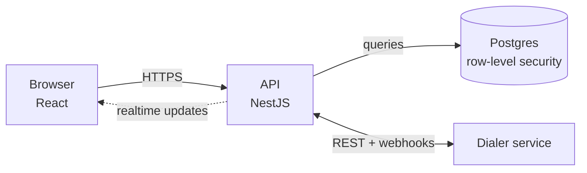

# Case Study: Multi-Tenant CRM for Appointment-Setting Teams

> Code is proprietary to an employer and is not included. This write-up describes my role and the engineering involved.

## Overview

A multi-tenant SaaS CRM for teams that cold-call prospects to book meetings. Many client businesses share one deployment, each strictly separated from the others. Every business gets role-based workspaces: callers work their call list, managers run campaigns and watch performance, and owners control the team.

## What I worked on

### Built by me

- **Role-based access:** caller, manager and owner seats, with rules on who may change whose role; email invitations where invitees set their own password; team management (deactivate, reactivate, promote); and an audit log of administrative actions.
- **Dialer integration:** automated dialing sessions driven from the CRM, inbound webhooks that sync call events, call recordings, and daily usage tracking per tenant. An in-browser softphone lets a caller take calls from the dashboard, and a manual dialing mode works alongside it.
- **Role-based workspaces:** separate workspaces for callers, managers and platform administrators, each showing only what that seat needs.
- **Platform admin console:** tenant management and lifecycle, support impersonation that records both identities, and operational alerts.
- **Callback scheduling ("call later"):** a caller records a callback time, and the lead stays active and is queued for that slot.
- **Lead management:** a step-by-step CSV import (upload, preview, confirm), search, bulk actions, notes and per-tenant custom fields.
- **Multi-stage call form:** picked up → gatekeeper → pitched → booked, with retirement and attempt-limit rules enforced in the database rather than the UI.
- **Campaigns:** round-robin lead distribution across staffed callers, meetings and a calendar, meeting reminders, and reporting such as cost per meeting booked and won.

## Architecture

## Engineering practices

- **Tenant isolation in the database.** Every business table carries a tenant key and is protected by Postgres row-level security, so separation is enforced at the database level, not left to each query.
- **Business rules in Postgres.** Funnel rules, metric roll-ups and phone normalisation run as triggers and functions, so every client follows the same rules.
- **Monorepo** with Bun workspaces sharing tooling across frontend, API and database.
- **Automated tests:** server integration suites against a real database, including tenant-isolation checks, plus frontend component tests.
- **Containerised deployment** with Docker.
- **CI/CD:** lint, typecheck, build and tests on every push, with forward-only database migrations applied before each release.

## What I learned

- **Put the rule where it can't be skipped.** Constraints in the database outlive any single client or service.
- **Test isolation with two tenants that look alike.** A missing tenant filter still returns plausible results when only one tenant has data.
- **Design permissions as seats, not flags.** A small fixed set of roles with clear rules is easier to reason about than ad-hoc grants.
- **Integrations are about reconciliation.** Webhooks arrive late, twice or not at all, so periodic reconciliation and idempotent handling matter as much as the happy path.
- **Make "nothing yet" different from "zero".** Keeping null distinct from 0 in reporting makes dashboards honest.
